<!--
  Profile README for github.com/amanjaiman1
  Artwork in assets/ is generated from scripts/content.py by scripts/build_assets.py.
  The 3D calendar and the snake are rebuilt daily by .github/workflows/profile-visuals.yml.
-->

  

  
  
  
  
  

  

  

  

  

  <a href="https://sortandvisualize.com"></a>
  <a href="https://frankcalculator.com"></a>

  <a href="https://aevoura.vercel.app"></a>
  <a href="https://topper-paper-socio.vercel.app"></a>

  <a href="https://try-test-eta.vercel.app"></a>
  <a href="https://jesus-2-five.vercel.app"></a>

  Every card opens the live site. Aevoura's template demos:
  <a href="https://temp-jwel.vercel.app">Aabha</a> (jewellery) ·
  <a href="https://temp-interior.vercel.app">Mātra</a> (architecture) ·
  <a href="https://temp-marketing-eight.vercel.app">Rhea Malik</a> (personal brand).
  Some of this code stays private while I build in stealth.

  

  

  

  

  

  <picture>
    <source media="(prefers-color-scheme: dark)" srcset="https://raw.githubusercontent.com/amanjaiman1/amanjaiman1/output/snake-dark.svg">
    <source media="(prefers-color-scheme: light)" srcset="https://raw.githubusercontent.com/amanjaiman1/amanjaiman1/output/snake-light.svg">
    
  </picture>

  

  

